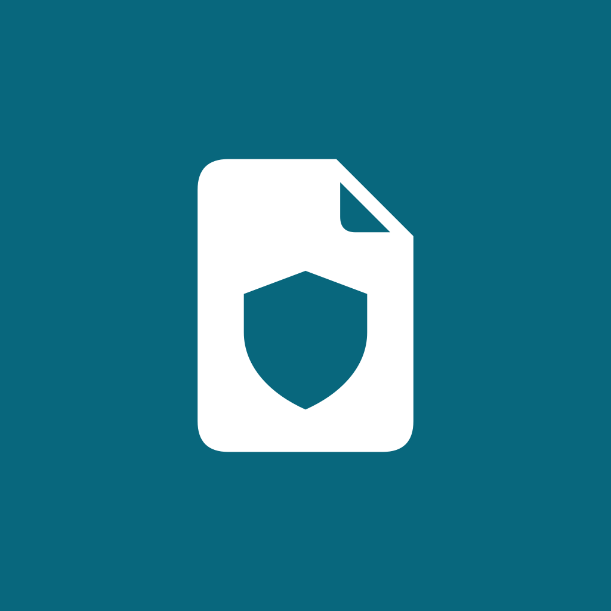

# FileGuard

<p align="center">
  
</p>

<p align="center">
  <strong>Análise estrita de arquivos e APKs no Android com privacidade, transparência e inteligência de ameaças via VirusTotal v3.</strong>
</p>

<p align="center">
  <a href="https://github.com/Andr3Dav1d/FileGuard/actions/workflows/ci.yml">
    
  </a>
  <a href="https://flutter.dev">
    
  </a>
  <a href="https://dart.dev">
    
  </a>
  <a href="https://developer.android.com">
    
  </a>
  <a href="https://www.virustotal.com">
    
  </a>
  <a href="#testes-automatizados">
    
  </a>
  <a href="LICENSE">
    
  </a>
</p>

---

## 🛡️ Visão Geral

O **FileGuard** é um aplicativo Android desenvolvido em Flutter projetado sob a filosofia *função antes da apresentação*. Seu objetivo é fornecer transparência e controle absoluto sobre a segurança de arquivos locais e instaladores de pacotes Android (APKs) antes de sua abertura ou instalação no sistema operacional.

O aplicativo opera com separação estrita de fronteiras de rede: consultas de reputação são feitas primariamente pelo hash criptográfico **SHA-256**, garantindo que o arquivo original **nunca seja transmitido** sem autorização explícita e consentida do usuário.

---

## ✨ Principais Recursos

- **⚡ Cálculo de SHA-256 em Streaming:** Processamento em blocos (*chunks*) de 64 KB via Storage Access Framework (SAF), permitindo analisar arquivos de múltiplos gigabytes sem esgotar a memória RAM.
- **🔍 Consulta Inteligente por Hash:** Verificação instantânea da assinatura do arquivo contra dezenas de motores de detecção de antivírus na API VirusTotal v3.
- **🔐 Upload Consentido com Termos Claros:** Se o arquivo for inédito no VirusTotal, o usuário é alertado e orientado sobre as implicações de privacidade antes de qualquer upload opcional.
- **📦 Instalação Segura de APKs:** Integração nativa Android via `FileProvider` e canal `MethodChannel`, permitindo abrir o instalador oficial do sistema apenas após inspeção satisfatória.
- **💾 Histórico Offline em SQLite:** Registro local criptografado de todas as análises realizadas, com busca por nome, hash e filtros por nível de ameaça (*Limpo*, *Suspeito*, *Malicioso*).
- **🔄 Backup & Restauração Desconectados:** Exportação e importação do histórico em formato JSON sanitizado, sem dependência de serviços em nuvem.
- **🎨 Design System Planar & AMOLED:** Interface desenvolvida com base nas especificações do Figma, oferecendo tema claro de alto contraste e tema escuro **Preto Absoluto AMOLED (`#000000`)**.
- **📱 Ícones Adaptativos & Themed Icons:** Suporte total a ícones adaptativos do Android e ícones monocromáticos dinâmicos para **Material You (Android 13+)**.
- **🔑 Keystore Seguro:** A chave de API do usuário é protegida com criptografia de hardware via `flutter_secure_storage` no Android Keystore.

---

## 🏛️ Arquitetura

O projeto adota os padrões **Feature-First** e **Clean Architecture**:

```text
lib/
├── app/                  # Bootstrap, temas globais e rotas com GoRouter
├── core/                 # Design System, tokens (cores, espaçamentos, tipografia) e widgets base
└── features/             # Módulos funcionais independentes
    ├── home/             # Dashboard inicial com métricas de proteção em tempo real
    ├── scanner/          # Seleção SAF, cálculo de hash, cliente VirusTotal e análise de APK
    │   ├── domain/       # Entidades puras, Value Objects e contratos abstratos
    │   ├── data/         # Data sources, clientes HTTP e repositórios
    │   └── presentation/ # Telas e gerenciamento de estado reativo com Riverpod
    ├── history/          # Banco de dados SQLite local e serviço de backup JSON
    ├── settings/         # Gerenciamento da API Key e seleção de tema
    └── onboarding/       # Apresentação inicial do aplicativo (Landing Page)
```

---

## 🚀 Como Executar

### Pré-requisitos
- [Flutter SDK](https://docs.flutter.dev/get-started/install) 3.47.x ou superior.
- [Java Development Kit (JDK)](https://adoptium.net) 17.
- [Android SDK](https://developer.android.com/studio) com suporte à API 21+ (recomendado API 34+).
- Dispositivo Android com depuração USB ativada ou emulador.

### Instalação

1. Clone o repositório:
```bash
git clone https://github.com/Andr3Dav1d/FileGuard.git
cd FileGuard
```

2. Obtenha as dependências:
```bash
flutter pub get
```

3. Execute a verificação de código:
```bash
flutter analyze
```

4. Execute a suíte de testes:
```bash
flutter test
```

5. Inicie a aplicação no dispositivo conectado:
```bash
flutter run
```

---

## 🧪 Testes Automatizados

O FileGuard conta com uma suíte de **36 testes automatizados** cobrindo todos os fluxos críticos:

- **Domínio & Regras de Negócio:** Cálculo de severidade (`ThreatLevel`), categorização de motores antivírus e conversão de status.
- **Criptografia & I/O:** Validação de cálculo SHA-256 em streaming por blocos e sanitização de dados.
- **Mocks de Repositório:** Simulação de respostas da API VirusTotal v3 (análises existentes, arquivos não encontrados, cotas esgotadas e timeouts com retry).
- **Persistência SQLite:** Testes de inserção, paginação, filtros e idempotência na restauração de backups JSON.
- **Interface & Acessibilidade:** Conformidade visual planar na resolução do Figma (412 × 917 dp), sem overflow e com contraste WCAG AA validado nos modos Claro e Escuro AMOLED.
- **Onboarding:** Validação do fluxo de boas-vindas e persistência de preferências de primeira inicialização.

Para executar todos os testes com saída detalhada:
```bash
flutter test --reporter expanded
```

---

## 🔒 Segurança e Privacidade

- **Princípio da Menor Exposição:** Nenhum arquivo binário é enviado para servidores externos sem clique explícito de confirmação em um diálogo dedicado.
- **Armazenamento de Credenciais:** Chaves de API privadas são mantidas exclusivamente no armazenamento seguro protegido por hardware do dispositivo Android (`EncryptedSharedPreferences` / Android Keystore).
- **Sem Telemetria Oculta:** O aplicativo não coleta análises, estatísticas ou relatórios dos arquivos do usuário. O histórico permanece 100% no banco de dados SQLite local.

---

## 📦 Integração Contínua (CI/CD)

- **CI (`FileGuard CI`):** Acionado a cada push na branch `dev` e pull requests para `main`, executando análise estática rigorosa (`flutter analyze`) e a suíte completa de testes (`flutter test`).
- **CD (`FileGuard CD`):** Acionado na branch `main` para assinar digitalmente e compilar APKs universais e particionados por arquitetura (`arm64-v8a`, `armeabi-v7a`, `x86_64`), publicando os binários automaticamente no GitHub Releases.

---

## 📄 Licença

Este projeto é distribuído sob os termos da licença **MIT**. Consulte o arquivo [LICENSE](LICENSE) para obter detalhes completos.

---

<p align="center">
  Desenvolvido por <a href="https://github.com/Andr3Dav1d">André David (Andr3Dav1d)</a>
</p>
