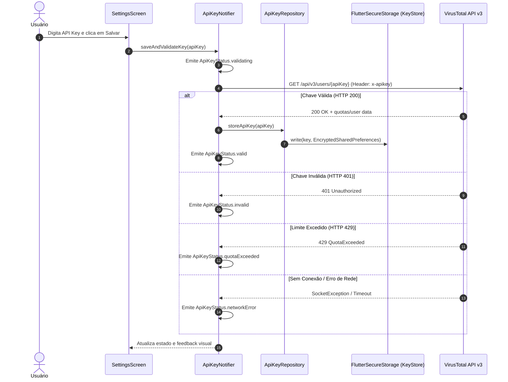
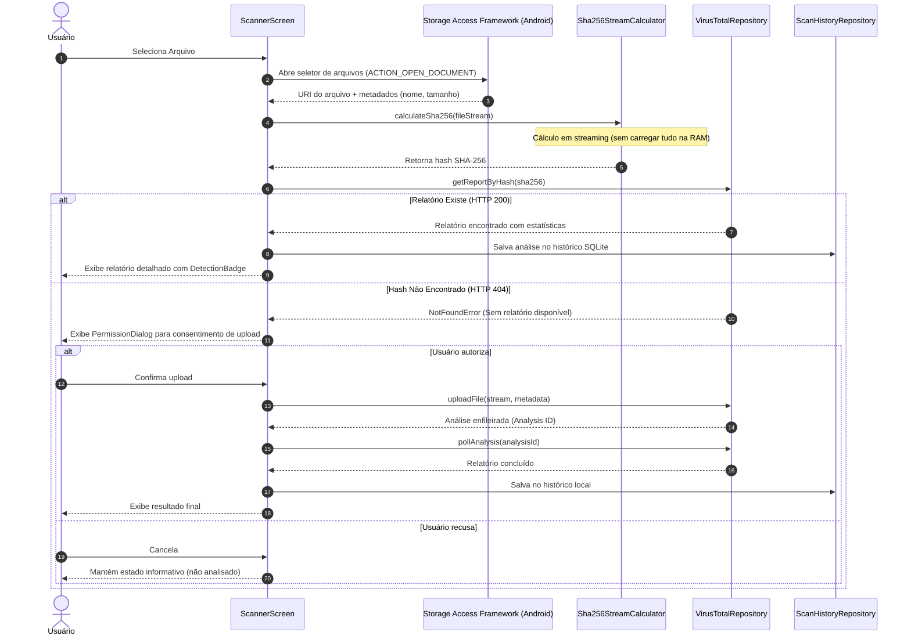

# FileGuard — Arquitetura e Fluxo de Dados

Este documento descreve a arquitetura técnica, organização de camadas e fluxos de dados do **FileGuard**, alinhado ao plano mestre de implementação.

---

## 1. Visão Geral da Arquitetura

O FileGuard adota o padrão **Feature-First** combinado com princípios de **Clean Architecture** e separação estrita de responsabilidades:

```text
lib/
├── app/                  # Bootstrap, roteamento e casca da aplicação (GoRouter, Shell)
├── core/                 # Infraestrutura compartilhada (tema, tokens, widgets base, l10n)
└── features/             # Módulos funcionais independentes
    ├── home/             # Dashboard inicial e resumo de segurança
    ├── scanner/          # Fluxo de seleção, hash, análise e upload de arquivos
    ├── history/          # Persistência local SQLite de relatórios anteriores
    └── settings/         # Gerenciamento seguro da API Key e preferências
```

---

## 2. Camadas por Funcionalidade

Cada funcionalidade em `lib/features/<nome>/` é subdividida em camadas:

1. **Domain (`domain/`)**:
   - **Entidades e Value Objects**: Representam os conceitos centrais do negócio (ex.: `ScanReport`, `AnalysisStats`, `ApiKeyStatus`).
   - **Contratos (Interfaces)**: Repositórios abstratos (ex.: `ApiKeyRepository`, `VirusTotalRepository`, `ScanHistoryRepository`). Não possui dependência de frameworks externos ou bibliotecas de I/O.

2. **Data (`data/`)**:
   - **Data Sources**: Comunicação direta com armazenamento seguro (`flutter_secure_storage`), HTTP (`http`), SQLite (`sqflite`) ou canais nativos.
   - **DTOs / Mappers**: Serialização JSON da API VirusTotal v3 e mapeamento bidirecional para as entidades de domínio.
   - **Implementações de Repositório**: Implementam os contratos de domínio.

3. **Application / State (`presentation/providers/` ou `application/`)**:
   - Gerenciamento de estado com **Riverpod** (`AsyncNotifier`, `Notifier`).
   - Coordenação de fluxos e validações.

4. **Presentation (`presentation/`)**:
   - Telas (`screens/`) e componentes específicos de cada feature (`widgets/`).
   - Consumo de estado reativo e despacho de eventos aos notifiers.

---

## 3. Fluxos de Dados Principais

### 3.1 Ciclo de Vida da API Key



### 3.2 Fluxo de Análise e Upload de Arquivos



---

## 4. Diretrizes de Segurança e Privacidade

- **Isolamento de Credenciais**: A API Key nunca transita para o disco em texto não criptografado. No Android, o `flutter_secure_storage` utiliza `EncryptedSharedPreferences` com chaves assimétricas gerenciadas pelo Android Keystore.
- **Não Exposição de Segredos**: Logs, mensagens de erro (`debugPrint`, `print`, crash reports) são sanitizados e nunca registram a API Key ou cabeçalhos sensíveis.
- **Zero Retenção de Arquivos**: O aplicativo não mantém cópias locais dos arquivos analisados após o cálculo do hash ou envio consentido.
- **Consentimento Obrigatório**: Nenhuma requisição de upload de binário é executada sem aprovação explícita e específica do usuário para aquele arquivo.
